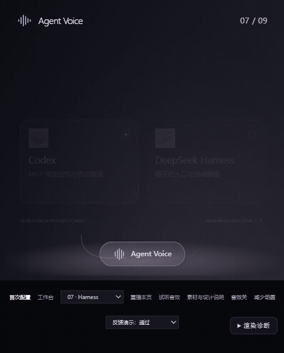

# 标题分组揭示 · 2026-10-19

用户认为上一版文字动画不明显、下划线覆盖不全。本轮只增强文字编排，不重做页面构图，AIRI 图标、插画、配色和构图保留。

## 原因与变化

原动画是标题整体 460ms、9px 的淡入。强调线放在 `.focus-word` 后面，只覆盖内容词；例如窄窗口“对话客户端。”宽约 194px，未包含前面的“连接”。

现在标题按语义分两组，动作词先揭示，内容词延后 120ms 从固定遮罩内向上揭示，分别持续 640ms、720ms。字形移动约一行高度，轻微旋转归位；说明在 260ms 后进入，操作区在 420ms 后进入。插画延后，文字先建立焦点。没有逐字符打字，没有字号或宽高动画。

强调线属于整个标题，使用完整标题宽度、3px 实线和更清楚的对比度。AIRI 的文字颜色保留，强调线使用配套粉色。旧的关键词伪元素和旧淡入规则已移除，文字动效集中维护在 `text-motion.css`，标题包装在 `page-compositions.js` 的 `prepareText`。

标题容器不移动，只有内部字形移动；原文字节点保留，包括 AIRI 的颜色节点。完整标题保存在 `aria-label` 中，避免屏幕阅读器按动画分组重复朗读。

## 证据与复测

`proof/text-motion/phrase-timeline.json` 记录了 0、180、400、650、1000ms 的真实 CSS 动画状态：字形移动和透明度不同，而标题外框位置与宽度恒定。结束时强调线为 258.875px，与整句标题宽度相同。

`title-reveal.gif` 是实际网页在 40ms 间隔下的 26 个渲染状态组成的逐帧预览，末尾停留 1.2 秒；不是手工重画的示意图，也不是性能或真实录屏帧率基准。临时原始截图留在本机可视化目录，仓库只保留预览和检查证据。

三种尺寸（390×800、1280×918、2560×1600）共 30 页检查：每页两个语义组，标题与可访问名称一致，强调线覆盖完整标题，无横向溢出或多余纵向溢出。减少动画模式下直接显示完整文字；连续重播不会嵌套包装标题。

诊断地址增加 `?diagnostics=1`，展开“渲染诊断”，通过“文字动画检查”选择时间，可以暂停在真实动画帧核对。该检查器仅在诊断模式出现；正常预览的“重播本页”重新播放完整文字与插画序列。Esc、离页、快速切换仍会结束并清理旧动画。

构建：`python build.py`。回归：`node --test tests/navigation-contract.test.cjs`。正式程序及真实语音链路没有改动，本稿仍供视觉审核。交接继续用 Git/GitHub。
